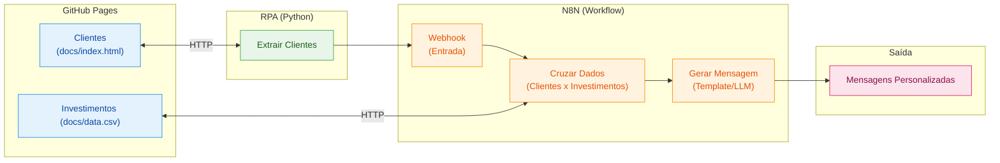
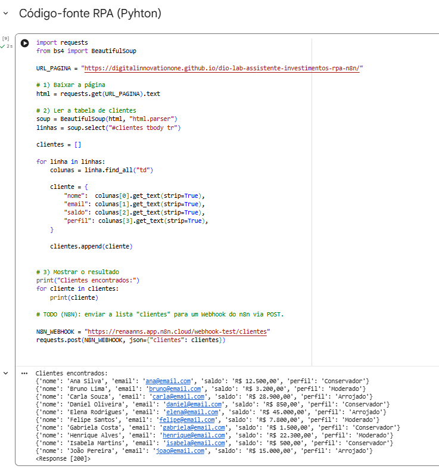
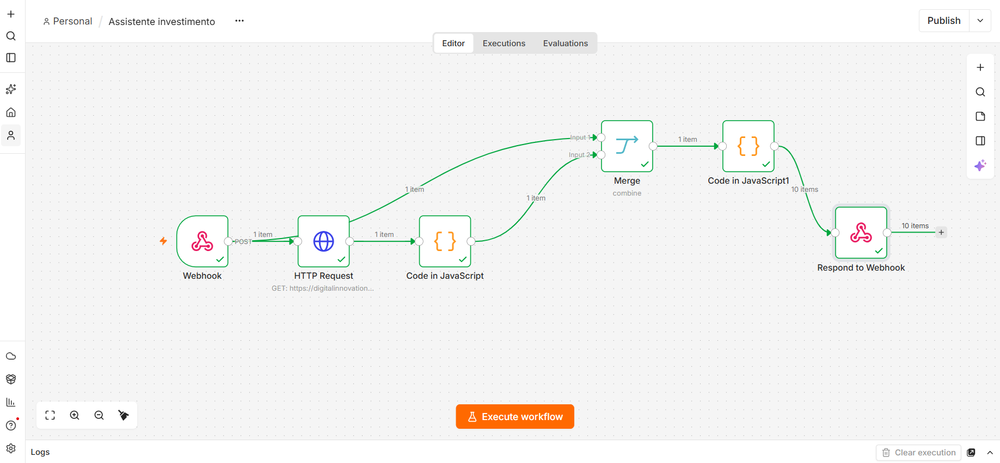
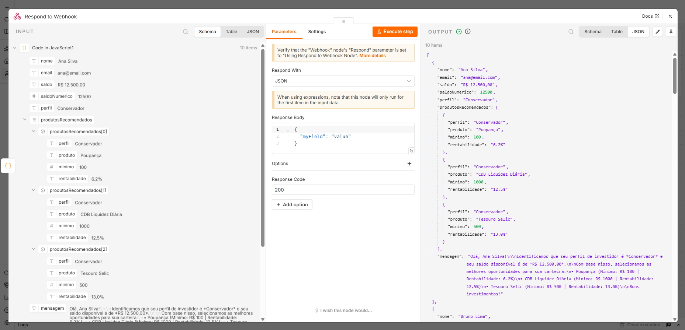
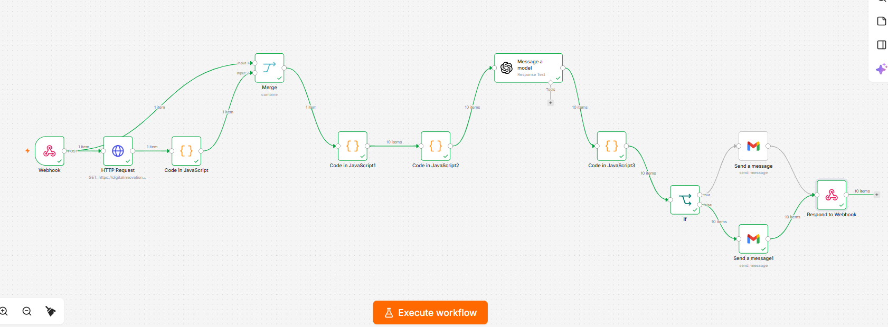
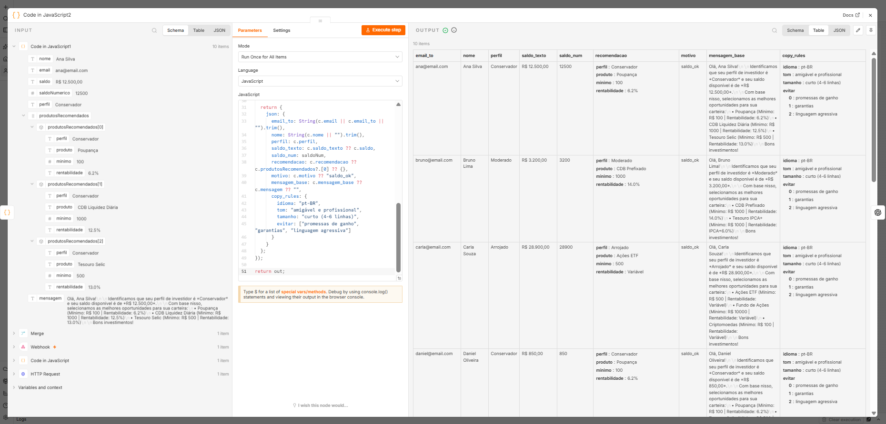
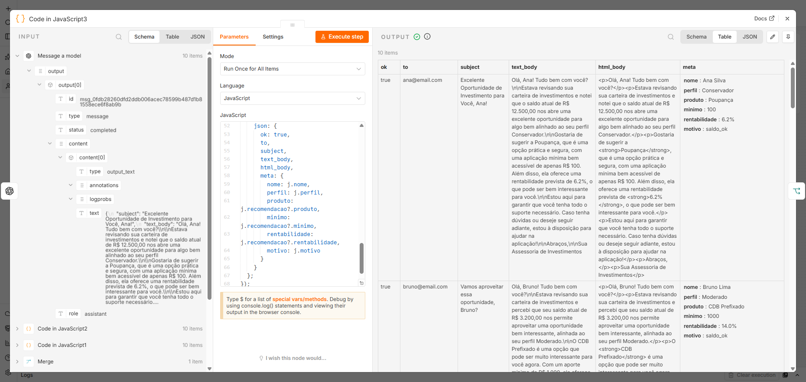
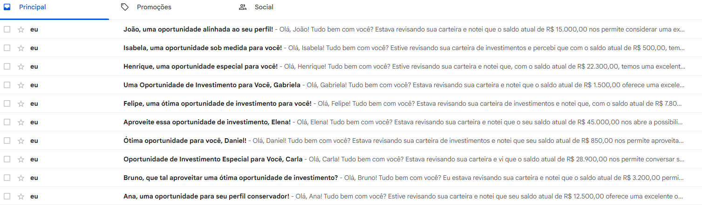

# Criando um Assistente de Investimentos com RPA e IA Generativa

## Descrição

Aprenda na prática como criar um fluxo de automação inteligente combinando técnicas de RPA (Robotic Process Automation) com workflows de IA no N8N.

Neste desafio, você vai construir um assistente de investimentos automatizado. O fluxo começa com a extração de dados de clientes em uma página web usando Python, passa pela orquestração de um workflow no N8N e termina com a geração de mensagens personalizadas para cada perfil de investidor.

O projeto foi pensado para ser simples e acessível, mesmo para quem está dando os primeiros passos em Python e automação. A ideia é que você entenda o conceito de RPA de forma leve e aplique tudo em um cenário realista do mercado financeiro.

## Objetivo do Projeto

Desenvolver um pipeline de automação que:

1. **Coleta dados de clientes** de uma página web simulada usando Python
2. **Processa as informações** através de um workflow no N8N
3. **Cruza perfis de investidor** com uma base de opções de investimento
4. **Gera mensagens personalizadas** para cada cliente

Ao final, você terá um sistema funcional que demonstra como empresas do setor financeiro podem automatizar a comunicação com clientes de forma inteligente.

## Arquitetura do Projeto



## Tecnologias e Ferramentas

O projeto utiliza ferramentas gratuitas e acessíveis, organizadas conforme cada etapa do fluxo:

| Etapa | Ferramenta | Função |
|-------|-----------|--------|
| Hospedagem | GitHub Pages | Servir a página de clientes e o CSV de investimentos |
| Extração (RPA) | Python + BeautifulSoup | Coletar dados dos clientes via web scraping |
| Orquestração | N8N | Processar dados, cruzar perfis e gerar mensagens |
| Geração com IA | Agente de IA no N8N | Criar mensagens personalizadas com LLM (desafio extra) |

Além dessas, você pode usar IAs generativas como **Gemini**, **Claude** ou **ChatGPT** como copilotos para auxiliar na escrita de código e tirar dúvidas ao longo do desenvolvimento.

## Roteiro do Desafio

### Etapa 1: Entenda o Projeto

Antes de começar, explore o repositório base que já contém a estrutura inicial:

1. **Página de Clientes (`docs/index.html`):** Uma página HTML hospedada no GitHub Pages com uma lista de clientes fictícios contendo nome, email, saldo e perfil de investidor (Conservador, Moderado ou Arrojado). Disponível online [neste link](https://digitalinnovationone.github.io/dio-lab-assistente-investimentos-rpa-n8n).
2. **Dados de Investimentos (`docs/data.csv`):** Um arquivo CSV também hospedado no GitHub Pages com opções de investimento organizadas por perfil. Disponível online [neste link](https://digitalinnovationone.github.io/dio-lab-assistente-investimentos-rpa-n8n/data.csv).
3. **Script de RPA (`src/extrair_clientes.ipynb`):** Um notebook Python que acessa a página de clientes e extrai os dados da tabela usando BeautifulSoup.

> 🤖 **Por que o script é considerado RPA?** Ele faz exatamente o que um humano faria manualmente: abre uma página, lê os dados de uma tabela e os envia para outro sistema. A diferença é que o "robô" (código) executa isso automaticamente. Essa abordagem é útil quando não existe uma API disponível ou quando precisamos integrar sistemas legados.

### Etapa 2: Configure o Ambiente

1. Faça um **fork** do repositório base para sua conta do GitHub
2. Crie uma conta no [N8N Cloud](https://n8n.io/) ou instale localmente
3. Abra o notebook `src/extrair_clientes.ipynb` no [Google Colab](https://colab.research.google.com/) e execute para entender o fluxo de extração

> 💡 **Atenção:** O script já extrai os dados, mas o envio ao N8N está comentado (`TODO`). Você vai configurar a URL do Webhook após criá-lo na próxima etapa.

### Etapa 3: Desenvolva o Workflow no N8N

Este é o coração do desafio! Monte um fluxo que:

1. Receba os dados dos clientes via Webhook (copie a URL gerada e configure no script Python)
2. Leia o arquivo `docs/data.csv` com as opções de investimento
3. Cruze o perfil de cada cliente com a opção adequada
4. Gere uma mensagem de recomendação para cada cliente

### Etapa 4 (MVP): Mensagens Estáticas

Para a versão mínima, use templates de mensagem fixos baseados no perfil:

- **Conservador:** Foco em renda fixa e segurança
- **Moderado:** Mix equilibrado entre renda fixa e variável
- **Arrojado:** Ênfase em ações e maior potencial de retorno

### Etapa 5 (Desafio): Integração com IA Generativa

Conecte o Agente de IA do N8N a um modelo como Gemini ou GPT para:

- Analisar o contexto do cliente (saldo, perfil)
- Gerar mensagens únicas e personalizadas
- Criar recomendações mais inteligentes e humanizadas

---

## Entregáveis

### MVP (Mínimo Viável)

- [x] Repositório forkado com o workflow N8N implementado
- [x] Workflow N8N exportado (`n8n/workflow.json`) com mensagens estáticas
- [x] Script de RPA integrado ao Webhook do N8N (`src/extrair_clientes.ipynb`)
- [x] Print ou vídeo demonstrando o fluxo funcionando de ponta a ponta

---

### 📸 Demonstração da Execução de Ponta a Ponta

#### 1. Extração RPA e Disparo para o Webhook (Google Colab)
> O script em Python faz a raspagem da tabela HTML dos clientes e realiza o POST com sucesso (`Status: 200`) para o Webhook do n8n.



#### 2. Orquestração e Processamento dos Dados (n8n)
> Fluxo completo executado com sucesso: recepção do Webhook, requisição do CSV de investimentos, tratamento via JavaScript, cruzamento dos dados e resposta HTTP.



#### 3. Mensagens e Recomendações Personalizadas Geradas
> Amostra do nó de saída com a mensagem gerada individualmente para cada cliente com base no saldo e no perfil de risco.



---

## Desafio Completo

Esta etapa expande o MVP estático original para uma arquitetura totalmente dinâmica orientada a Inteligência Artificial e automação de ponta a ponta.

### Arquitetura do Fluxo no n8n
> Abaixo está o pipeline completo implementado e validado em ambiente de execução:



---

### Requisitos Contemplados

- [x] **Todos os itens do MVP:** Extração de clientes via Python/Colab, enriquecimento de produtos de investimento e orquestração via Webhook/Merge no n8n.
- [x] **Integração com Agente de IA no n8n:** Orquestração com nó de LLM (GPT-4o) para contextualização individual.
- [x] **Mensagens geradas dinamicamente via LLM:** Redação consultiva, humanizada e empática, gerando e-mails com assuntos únicos e conteúdos adaptados ao saldo e perfil de cada investidor.
- [x] **Documentação técnica:** Detalhamento das decisões de arquitetura de dados, mitigação de alucinações e estratégia de validação de envio.

---

### Decisões Técnicas e Arquitetura do Fluxo

#### 1. Pré-processamento e Guardrails de Conteúdo (`Code in JavaScript2`)
> Antes de encaminhar os dados para a LLM, os registros de cada cliente passam por higienização estrita:

- **Normalização Cambial:** Conversão resiliente de strings monetárias em formato brasileiro (`R$ 12.500,00`) para valores numéricos utilizáveis (`12500`).
- **Injeção de Regras de Copywriting (`copy_rules`):** Inclusão de metadados como tom (`"amigável e profissional"`), tamanho (`"curto (4-6 linhas)"`) e diretrizes de compliance financeiro (`evitar: ["promessas de ganho", "garantias", "linguagem agressiva"]`). Isso ancora a IA aos limites regulatórios das normas CVM/ANBIMA, eliminando riscos de alucinação de rentabilidade.



#### 2. Geração Dinâmica via LLM (`Message a model`) e Pós-Processamento (`Code in JavaScript3`)
> O prompt utiliza as variáveis estruturadas de cada investidor para gerar uma comunicação personalizada e empática:

- O primeiro nome do cliente e o saldo disponível são citados naturalmente no corpo da mensagem.
- O ativo financeiro indicado respeita rigorosamente o aporte mínimo e o perfil de risco já calculados pela regra de negócio.
- A resposta é forçada a retornar um contrato de dados JSON fechado com as chaves: `subject`, `text_body` e `html_body`.
- O nó subsequente decodifica o JSON, remove blocos de formatação markdown (````json ... ````) e preserva os metadados cadastrais originais.



#### 3. Estratégia do Nó `If`: Validação e Roteamento de Testes (Sandbox)
> Uma decisão central de arquitetura foi a inserção do nó condicional `If` utilizando validação via Regex (`^[^\s@]+@[^\s@]+\.[^\s@]+$`):

- **O Desafio:** A base de dados sintética de demonstração utiliza endereços fictícios (ex.: `ana@email.com`, `bruno@email.com`). Disparar envios diretos para esses destinatários acarretaria falhas imediatas de entrega (*delivery failure*), erros de conexão SMTP e bloqueios temporários de cota no Google Cloud / Gmail API.
- **A Solução (Roteamento de Fallback/Sandbox):** O nó `If` foi configurado para avaliar a validade do endereço de destino. O fluxo desvia os disparos pela rota de tratamento de exceção/sandbox (`false`), substituindo o destinatário real por uma caixa de correio controlada de testes.
- **Resultado:** Foram entregues com sucesso os **10 e-mails únicos**, comprovando que cada assunto, saudação e corpo gerados pela IA foram entregues com formatação rica (HTML) sem que nenhum erro de rede interrompesse a automação.



---

## Estrutura do Repositório

```
📁 dio-lab-assistente-investimentos-rpa-n8n/
├── 📄 README.md
├── 📁 src/
│   └── 📄 extrair_clientes.ipynb   # ✅ Notebook Python (já implementado, falta só o TODO)
├── 📁 n8n/
│   └── 📄 workflow.json            # 🎯 Seu desafio: exportar o workflow aqui
└── 📁 docs/
    ├── 📄 index.html               # ✅ Página de clientes (já implementado)
    └── 📄 data.csv                 # ✅ Opções de investimento (já implementado)
```

## Prompts Úteis para Copilotos de IA

| Tarefa | Sugestão de Prompt |
|--------|-------------------|
| Gerar dados fictícios | "Crie 10 clientes fictícios com nome, email, saldo e perfil de investidor em JSON" |
| Entender código | "Explique o que faz a biblioteca BeautifulSoup em Python" |
| Debugar erros | "Meu script Python está dando erro X, o que pode ser?" |
| Montar workflow | "Como configuro um webhook no N8N para receber dados JSON?" |

## Referências

- [Documentação do N8N](https://docs.n8n.io/)
- [BeautifulSoup: Web Scraping com Python](https://realpython.com/beautiful-soup-web-scraper-python/)
- [GitHub Pages: Guia Rápido](https://pages.github.com/)

---

**Bons estudos e mãos à obra** 🚀

Se tiver dúvidas, lembre-se: a melhor forma de aprender é experimentando. Erre, corrija e celebre cada pequena vitória no caminho.
